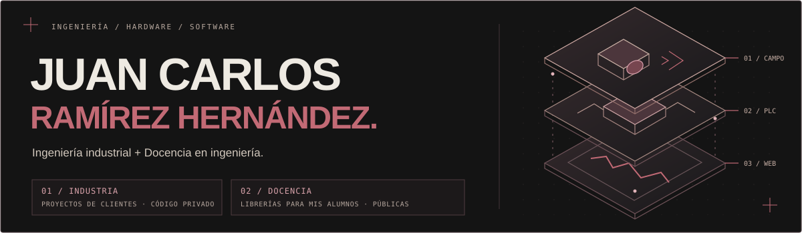

  

Hago que el hardware y el software trabajen juntos. Desarrollo plataformas web, integro equipos industriales y convierto señales en información útil: desde una cámara o un sensor hasta el sistema que permite trabajar con esos datos.

**[Explorar mi portafolio ↗](https://carlos-hernandez-q.github.io/)** · [Contacto](mailto:juanramirezupav@gmail.com) · Xalapa, Veracruz, México

### Trabajo seleccionado

| Proyecto | Mi trabajo |
| :--- | :--- |
| **[Escitala ↗](https://carlos-hernandez-q.github.io/#escitala)** | Plataforma geoespacial: importación, trazabilidad, permisos, mapas y rutas. **Go · React · PostGIS · MapLibre** |
| **[Fotomultas ↗](https://carlos-hernandez-q.github.io/#fotomultas)** | Integración de cámaras, eventos de velocidad y evidencia con servicios de procesamiento. **Python · Dahua · RTSP · MQTT** |
| **[MARTLO ↗](https://carlos-hernandez-q.github.io/#martlo)** | Plataforma web para gestionar dispositivos, variables y datos operativos. **React · APIs · SQL · MQTT** |
| **[Narmex ↗](https://carlos-hernandez-q.github.io/#narmex)** | Programación e integración de control y conteo visual de piezas. **Allen-Bradley Micro850 · Keyence IV4 · Structured Text** |

### Herramientas del oficio

**Software y datos**

Python · Go · C/C++ · JavaScript/TypeScript · React · Laravel · Flask · PostgreSQL

**Control y visión**

Allen-Bradley · Siemens · Keyence · PLC/HMI · Structured Text · Modbus TCP/RTU · Cámaras IP

**Electrónica y embebidos**

ESP32 · RP2040 · Raspberry Pi · Instrumentación · MQTT · UART · Linux · Docker

### También en el aula

Docente en el **Instituto Tecnológico Superior de Xalapa — 2025–actual**. Llevo al aula la experiencia de programación, electrónica e integración de equipos, con formación práctica para estudiantes de ingeniería.

---

**Del campo a la plataforma.** [Conoce los proyectos y sus etapas de desarrollo ↗](https://carlos-hernandez-q.github.io/#proyectos)
